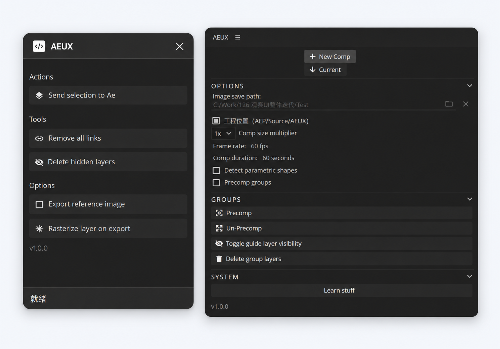

# AEUX 1.0.3

[中文](#中文) · [English](#english) · [Download / 下载](https://github.com/dreamstring/AEUX/releases/tag/v1.0.3)

Maintained by [Dring Qian / dreamstring](https://github.com/dreamstring), based on [AEUX by Adam Plouff and upstream contributors](https://github.com/google/AEUX). Independent community fork; not an official Google or Adobe product. Apache 2.0.

## 中文

将 Figma 图层传入 After Effects，尽量保留可编辑的文字、形状、图片和层级。1.0.3 以当前认可的修复版本为基础，后续继续增加兼容性。

### 1.0.3 新增

单一图片填充、统一样式且无描边和效果的文字，可导入为可编辑文字 Alpha 遮罩＋独立纹理层，不增加预合成。已验证 TILE 240% 样例。纹理覆盖原文字框，编辑后超出原框不会自动扩展；复杂外观仍使用原有回退。

### 相对旧版的改进

下表针对本次排查中发现的旧版问题，不代表旧版完全不具备这些功能。

| 场景 | 旧版遇到的问题 | 1.0.3 |
| --- | --- | --- |
| 多层嵌套 Frame / Group | 部分图层位置、图片边界不正确 | 修正矩阵与坐标空间处理，改善嵌套定位 |
| Auto Layout 与适配后的布局 | 部分嵌套布局转换偏移 | 按 Figma 当前已计算的位置导入；不是在 AE 中重建响应式布局系统 |
| 旋转、水平 / 垂直翻转 | 中心和方向可能错误 | 改善完整矩阵和翻转处理 |
| 图片与超大图片 | 裁切、尺寸不匹配或导出失败 | 增加边界元数据及大图处理；仍受宿主尺寸和内存限制 |
| 文字 | 部分位置、字距、复杂填充导致异常 | 修正定位与字距，必要时使用外观回退 |
| 模糊、阴影、透明度 | 数值转换不一致；翻转阴影可能报负值错误 | 调整转换并保留 0 透明度，修复阴影距离问题 |
| 蒙版、裁剪、圆角 | 部分作用域或嵌套结果异常 | 改善作用域、Frame 裁剪与圆角处理 |
| 资源输出目录 | 原有自定义图片目录 | 保留目录选择，增加工程位置选项：AEP 所在目录下的 Source/AEUX |
| 发送反馈 | 大图、复杂图层失败时难判断 | 增加进度与错误提示 |

**编辑性与限制：** 支持的文字和形状优先保持可编辑。裁剪、蒙版及隔离可能需要预合成，复杂文字外观可能按图导出。并非任意深度、任意 Figma 效果都保证完全一致；字体替换、背景模糊及部分填充 / 描边混合模式仍可能存在差异。默认不包含实验性的柔光运算辅助层方案。

### 安装 CEP（Windows）

1. 下载本页 Release 的 **AEUX-1.0.3.zip** 并解压。先保存工程并退出 AE。
2. 备份并移走现有 AEUX 扩展文件夹，避免重复加载同名扩展。
3. 在资源管理器地址栏粘贴：

   ~~~text
   %CommonProgramFiles(x86)%\Adobe\CEP\extensions
   ~~~

   目录不存在时新建。把压缩包中的 **CEP/AEUX** 整个文件夹复制进去。最终应是：

   ~~~text
   %CommonProgramFiles(x86)%\Adobe\CEP\extensions\AEUX\CSXS\manifest.xml
   ~~~

   复制时若系统提示需要管理员权限，允许后继续。

### 导入 Figma 插件

1. 把解压后的 **Figma** 文件夹放在固定位置，不要删除里面的 dist 文件夹。
2. 在 Figma 桌面端打开 Design 文件，选择 **Plugins → Development → Import plugin from manifest…**（插件 → 开发 → 从 manifest 导入）。
3. 选择 **Figma/manifest.json**，然后从 **Plugins → Development → AEUX** 运行。
4. 更新时保留相同文件夹路径，关闭后重新运行插件；必要时重新导入 manifest。

### 使用

先打开 AE 的 AEUX 面板，设置 **New Comp**（新合成）或 **Current**（当前合成）。在 Figma 选择要发送的 Frame，再点 **Send selection to Ae**。

CEP 的 **Image save path** 可选择导入图片的落盘目录。勾选 **工程位置（AEP/Source/AEUX）** 时，请先保存 AEP；图片放到该工程目录下的 Source/AEUX。这是素材目录，不是修改 AEP 保存路径。保留素材文件，移动工程时一并移动。尽量关闭 **Precomp groups** 以减少普通分组的预合成；必要的裁剪 / 蒙版结构仍会保留。

## English

New in 1.0.3: uniform text with one image fill and no visible strokes or effects imports as editable native text used as an Alpha matte for a separate texture layer, without an extra precomp. Validated with TILE 240%. Texture coverage stays within the original text frame; edits outside it do not automatically extend the texture. Complex appearances retain the existing fallback.

Transfer Figma layers to After Effects while retaining editable text, shapes, images and hierarchy where supported. Version 1.0.3 establishes the currently accepted repair baseline.

### Improvements over the original workflow

The original already supported these broad features; this fork fixes specific conversion failures rather than claiming they were entirely absent.

| Area | Improvements in 1.0.3 |
| --- | --- |
| Nested frames and groups | Matrix-based placement and more accurate raster bounds |
| Auto Layout / resized designs | Import Figma's resolved layout positions; does not recreate responsive layout behavior in AE |
| Rotation and reflection | Corrected center and flip handling |
| Raster assets | Bounds metadata, crop handling and oversized-image handling within host limits |
| Text | Placement, tracking and complex-appearance fallback handling |
| Appearance | Blur conversion, shadow-distance safeguards and zero-opacity preservation |
| Masks and clipping | Improved scope, frame clipping and rounded corners |
| Asset directory | Custom image directory plus project-relative Source/AEUX option |
| Feedback | Export progress and actionable failure messages |

Editable layers are preferred. Clipping, masks and isolation can require precomps; some text appearances require raster fallback. Arbitrary nesting and every Figma effect are not guaranteed pixel-identical. Fonts, background blur and some combined fill/stroke blends can differ. Experimental Soft Light arithmetic helper graphs are excluded by default.

### Windows CEP installation

1. Download **AEUX-1.0.3.zip** from [Releases](https://github.com/dreamstring/AEUX/releases/tag/v1.0.3). Extract it, save your project and quit AE.
2. Back up and move any previous AEUX extension outside CEP extension directories.
3. Paste **%CommonProgramFiles(x86)%\Adobe\CEP\extensions** into File Explorer. Create it if necessary. Copy the complete **CEP/AEUX** directory there. The resulting file must be **%CommonProgramFiles(x86)%\Adobe\CEP\extensions\AEUX\CSXS\manifest.xml**.
Copying to this system-wide directory may require administrator permission.

### Figma installation and use

Keep the extracted **Figma** directory in a permanent location, including dist. In Figma desktop, open a Design file, choose **Plugins → Development → Import plugin from manifest…**, and select **Figma/manifest.json**. Run **Development → AEUX**. This follows the [official Figma sample-plugin workflow](https://github.com/figma/plugin-samples).

Open the AEUX panel in AE, select **New Comp** or **Current**, then select a frame in Figma and click **Send selection to Ae**. Set **Image save path** for exported image assets, or enable **工程位置 (AEP/Source/AEUX)** to store assets under the saved AEP's directory. Save the AEP first. This setting controls image assets, not the AEP save location. Keep those assets with the project. Disable **Precomp groups** to reduce optional group precomps; necessary clipping/mask structures remain.

## Development / 开发

统一离线构建与打包：Node.js 22（推荐 22.3.0），运行 npm run build。无需启动 Figma／AE，也无需安装构建依赖。npm run check 执行回归测试、冻结的 1.0.2 全文件字节对照和两次 ZIP 可复现检查。详见 [BUILD.md](BUILD.md)。

Build the paired package offline with Node.js 22 (22.3.0 recommended): npm run build. No Figma, AE or dependency installation is required. Run npm run check for regression tests, complete frozen 1.0.2 file parity and repeated ZIP reproducibility. See [BUILD.md](BUILD.md).

The legacy compiled frontend and pinned runtime dependencies are vendored inputs; repair modules and the AE host are regenerated from maintained source. This is reproducible runtime assembly, not yet a full recompilation of every legacy Vue/TypeScript frontend module. Tested desktop workflows focus on Windows AE 23.5 and Figma 126.10.7; other host versions require testing.

## License / 许可证

[Apache 2.0](LICENSE.md). Original AEUX: Adam Plouff and upstream contributors. Maintenance and repairs: Dring Qian (dreamstring). Third-party runtime dependencies retain their own licenses.
